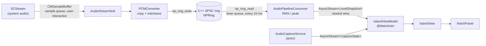
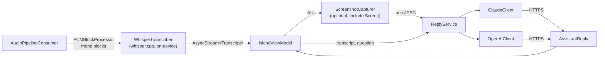
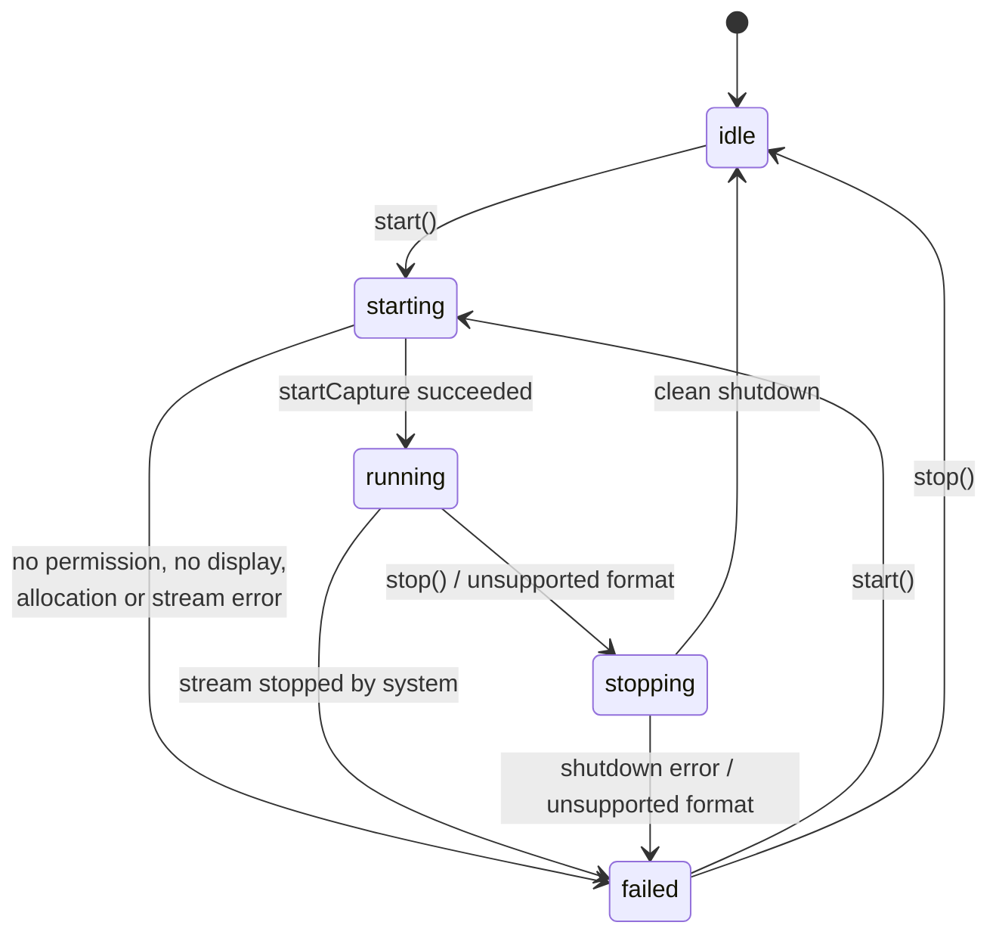

# NotchPilot

NotchPilot is a macOS menu-bar utility with a Dynamic-Island-inspired panel at the top of the primary display. When you start it, it captures system audio (what your Mac plays, not the microphone) through ScreenCaptureKit and passes the samples through a C++20 lock-free single-producer/single-consumer (SPSC) ring buffer to a non-real-time consumer that measures levels for the island's meter. Capture is off until you turn it on. While capture runs, the audio is transcribed on this Mac with [whisper.cpp](https://github.com/ggml-org/whisper.cpp) (a model you download once from Settings), and when you press **Ask** the recent transcript is sent to an AI reply service of your choice (Claude through the Anthropic Messages API, or ChatGPT through the OpenAI Chat Completions API) using your own API key, optionally with one on-demand screenshot of the main display. NotchPilot is not affiliated with Apple and does not imitate system UI; the island is its own opaque black panel.

- [Prerequisites](#prerequisites)
- [Build, run, test](#build-run-test)
- [Project layout](#project-layout)
- [Architecture](#architecture)
- [Audio format and real-time contract](#audio-format-and-real-time-contract)
- [Assistant: transcription, replies and screenshots](#assistant-transcription-replies-and-screenshots)
- [Settings window](#settings-window)
- [Window behaviour](#window-behaviour)
- [Configuration](#configuration)
- [Permissions and privacy](#permissions-and-privacy)
- [Known limitations](#known-limitations)
- [Troubleshooting](#troubleshooting)
- [License](#license)

## Prerequisites

| Requirement | Detail |
|---|---|
| Mac | Apple silicon (any M-series chip), 8 GB of memory or more. Intel Macs are not supported |
| macOS | 14 or later (`platforms: [.macOS(.v14)]`) |
| Toolchain | Xcode 16+ / Swift 6.0+ with Swift/C++ interoperability (available since Swift 5.9) |
| CMake | 3.28+ (`brew install cmake`), to build whisper.cpp from source on first build; plus `git` |
| Verified with | Xcode 27.0, Swift 6.4, macOS (arm64) |

`Package.swift` uses `// swift-tools-version: 6.0`, so older toolchains fail with a clear message.

**C++ interoperability.** `NotchPilotCore`, `NotchPilot` and the test target enable `.interoperabilityMode(.Cxx)` (shared through `swiftCommon` in `Package.swift`). Every Swift target that imports `NPRingBuffer` needs it. If interop is off, `Sources/NPRingBuffer/include/NPRingBuffer.h` stops the build with this `#error`:

```
NPRingBuffer.h must be compiled as C++. Enable Swift C++ interoperability: SwiftPM `.interoperabilityMode(.Cxx)` or Xcode 'C++ and Objective-C Interoperability' = 'C++ / Objective-C++' (-cxx-interoperability-mode=default).
```

If you add the sources to an Xcode project, set **C++ and Objective-C Interoperability** to **C++ / Objective-C++** on every Swift target that imports `NPRingBuffer`.

## Build, run, test

Scripts (`scripts/`):

```sh
scripts/build.sh            # release build (arm64), assembles and signs NotchPilot.app
scripts/build.sh --debug    # debug build (enables the C++ ownership asserts)
scripts/build.sh --run      # build, then launch the app
scripts/build-whisper.sh     # build Vendor/whisper.xcframework from pinned source (build.sh/test.sh run it when missing)
scripts/build.sh --help
scripts/test.sh             # swift test (229 Swift tests) + C++ tests under TSan and ASan/UBSan
scripts/test.sh --cpp-only  # C++ tests only
```

`scripts/build.sh` signs ad hoc by default. Set `CODESIGN_IDENTITY` to a stable identity (see [Troubleshooting](#troubleshooting)):

```sh
CODESIGN_IDENTITY="Apple Development: Your Name (TEAMID)" scripts/build.sh --run
```

`Resources/Info.plist` sets `LSUIElement` (no Dock icon) and bundle identifier `app.notchpilot.NotchPilot`. It has no usage-description keys: Screen & System Audio Recording has no Info.plist key, transcription needs no permission (whisper.cpp runs in-process), and NotchPilot never touches the microphone or camera.

**whisper.cpp.** whisper.cpp is built from source and linked statically into the executable. `scripts/build-whisper.sh` clones upstream tag `v1.9.5`, refuses to build unless the checked-out commit is exactly `d1be6fde11ac6e0407606b4e42fe72d34add8037`, compiles it with CMake for arm64 only (macOS 14, Metal with the shader library embedded, Accelerate for BLAS, CPU code for the M1 baseline `-mcpu=apple-m1`, which every later Apple chip runs natively; the model itself runs on the GPU, which adapts to each chip), and packages one static library as `Vendor/whisper.xcframework`, which `Package.swift` uses as the `whisper` binary target. A stamp file records the commit, so later runs skip the work; `--force` rebuilds. `scripts/build.sh` and `scripts/test.sh` run it automatically when the framework is missing; that first build compiles whisper.cpp, which took about 15 s on a 10-core Apple silicon Mac (allow a few minutes on slower machines). The app bundle therefore contains no third-party dylib, needs no entitlements, and keeps the hardened runtime's library validation on, including for ad-hoc builds (`otool -L build/NotchPilot.app/Contents/MacOS/NotchPilot` lists only system libraries).

### Giving the app to someone else

Build with `scripts/build.sh`. The app is arm64 (`lipo -archs build/NotchPilot.app/Contents/MacOS/NotchPilot` prints `arm64`) and runs on any Apple silicon Mac (M1 or later) with macOS 14 or later; Intel Macs can't open it. Zip it (`ditto -c -k --keepParent build/NotchPilot.app NotchPilot.zip`) and send it.

The ad-hoc signed app is not notarized, so on the other Mac Gatekeeper blocks the first launch:

1. Unzip, move NotchPilot to Applications and double-click it. macOS says it can't verify the app; click **Done** (not Move to Trash).
2. Open System Settings > Privacy & Security, scroll to Security, and click **Open Anyway** next to the NotchPilot message. Confirm with your password, then **Open**.
3. From then on it opens normally. Settings › Speech downloads the recommended speech model on first use.

Raw SwiftPM equivalents:

```sh
swift build                 # debug
swift build -c release
swift run NotchPilot        # runs the bare executable (no app bundle)
swift test                  # Swift tests (NotchPilotCoreTests, 229 tests)
```

`swift run` works for UI work because `main.swift` sets the `.accessory` activation policy itself. For a stable TCC identity use the bundled app from `scripts/build.sh`.

**Why SwiftPM instead of an `.xcodeproj`.** The project builds reproducibly from the command line with no project generator (xcodegen was not available), the C++ target, interop flag and C++20 standard are declared in one reviewable `Package.swift`, and there is no generated project file to keep in sync. The `.app` bundle is assembled by `scripts/build.sh`.

## Project layout

```
Package.swift
Resources/Info.plist             LSUIElement, bundle id, NSSpeechRecognitionUsageDescription
scripts/build.sh, test.sh
Sources/
  NPRingBuffer/                  C++20 target
    include/NPRingBuffer.h       only surface Swift imports (opaque NPRing* + np_ring_* functions)
    SPSCRingBuffer.hpp           np::SPSCRingBuffer<Sample> template
    NPRingBuffer.cpp             bridge implementation
  NotchPilotCore/                Swift 6 + C++ interop, no AppKit UI
    Config/NotchPilotConfig.swift
    Geometry/IslandGeometry.swift     pure layout math (DisplayMetrics, IslandPresentation)
    Audio/AudioCaptureService.swift   actor: SCStream lifecycle, CaptureState
    Audio/AudioStreamSink.swift       SCStreamOutput on the sample queue (real-time producer)
    Audio/PCMConverter.swift          CMSampleBuffer -> interleaved Float32
    Audio/RingBuffer.swift            ~Copyable RingProducer / RingConsumer over NPRing
    Audio/AudioPipelineConsumer.swift timer-driven drain, levels, AsyncStream output
    Audio/CaptureError.swift
    Assistant/AssistantInterfaces.swift  AIProvider, AssistantSettings, ReplyRequest, AssistantReply,
                                         AssistantError, Transcript, TranscriptionState, protocols
    Assistant/ReplyTextCoalescer.swift   batches streamed deltas to ~30 UI updates per second
    Assistant/SummaryEligibility.swift   when the island offers Summarize (≥ 30 words, capture stopped)
    Input/HotKeyFormatting.swift         HotKey glyphs (⌃⌥⇧⌘), spoken form, validation
    Input/DoublePressDetector.swift      quick second press of the Ask shortcut, QuickAskPressRouter
    Speech/WhisperTranscriber.swift      PCMBlockProcessor; whisper.cpp inference off the audio path
    Speech/WhisperWindowing.swift        rolling 16 kHz window, RMS speech detection, commit rules,
                                         hallucination filter (pure, unit-tested)
    Speech/WhisperContext.swift          one loaded whisper model (C API wrapper, abort callback)
    Speech/AudioResampler.swift          streaming AVAudioConverter, e.g. 48 kHz -> 16 kHz mono
    Speech/SpeechModelStore.swift        model download, SHA-256 verification, install, delete
    Speech/SpeechText.swift
    AI/ReplyService.swift, ClaudeClient.swift, OpenAIClient.swift
    AI/ProviderHTTP.swift, KeychainAPIKeyStore.swift
    Screenshot/ScreenshotCapturer.swift  SCScreenshotManager, JPEG in memory
  NotchPilot/                    AppKit/SwiftUI executable
    App/main.swift, AppDelegate.swift, MainMenu.swift
    MenuBar/StatusItemController.swift
    Settings/SettingsWindowController.swift  toolbar panes: General, Assistant, Speech
    Settings/GeneralSettingsPane.swift, SettingsView.swift (Assistant), SpeechSettingsPane.swift
    Settings/ShortcutRecorder.swift, SpeechModelsController.swift, AssistantSettingsStore.swift
    Input/HotKeyCenter.swift         global Ask shortcut (Carbon RegisterEventHotKey)
    Panel/NotchPanel.swift, IslandPanelController.swift
    Island/IslandViewModel.swift, IslandView.swift, IslandShape.swift, AssistantViews.swift
    Island/ChatViews.swift           mode row (Ask Once / Chat), Chat conversation
Tests/
  NotchPilotCoreTests/           Swift Testing
  cpp/ring_buffer_tests.cpp      standalone C++ tests (no framework)
```

## Architecture

### Data flow



Assistant extension (see [Assistant](#assistant-transcription-replies-and-screenshots)):



Format problems found on the real-time path do not call out: the sink records them in the ring's reject counters, and the consumer polls them and notifies `AudioCaptureService`.

### Capture state machine

`CaptureState` in `AudioCaptureService.swift`:



`start()` is ignored while the state is `starting`, `running` or `stopping`. `start()` and `stop()` are serialised through a task chain. Pressing Stop while starting also sets a cancellation flag that `performStart` checks after every suspension point, so a start in progress is abandoned (and a stream that already started is torn down) instead of capturing first.

### Threading and isolation

| Component | Runs on | Notes |
|---|---|---|
| `AudioCaptureService` | its own actor | Owns `SCStream`, `Session` (stream, sink, consumer), state. Never on the real-time path. |
| `AudioStreamSink`, `PCMConverter` | serial queue `app.notchpilot.audio-capture` (`.userInteractive`) | Real-time producer. No allocation, locks, logging, actor hops or UI work. |
| C++ ring | any thread | One producer side, one consumer side; atomics only. |
| `AudioPipelineConsumer` | serial queue `app.notchpilot.audio-consumer` (`.userInitiated`) | `DispatchSourceTimer` (non-blocking), drains full blocks, vDSP RMS/peak. |
| `IslandViewModel`, `IslandView`, `NotchPanel`, `IslandPanelController`, `StatusItemController`, `AppDelegate` | `@MainActor` | Only receive bounded `AsyncStream` values; never touched by audio threads. |

`states` is `bufferingNewest(8)`; `levels` is `bufferingNewest(1)`.

### Audited `@unchecked Sendable` boundaries

| Type | Invariant (from the code comments) |
|---|---|
| `RingStorage` (`RingBuffer.swift`) | Only mutable state lives behind the C++ atomics; Swift stored properties are immutable. It owns the `NPRing` and destroys it in `deinit`. Producer and consumer hold strong references, so the C++ object outlives every caller, including a late capture callback racing teardown. |
| `RingProducer`, `RingConsumer` (`RingBuffer.swift`) | `~Copyable`, so a handle has one owner. `RingBuffer.init` creates exactly one of each, which enforces SPSC in the type system. Moving a handle to the queue that uses it is the intended use; the C++ side synchronises with acquire/release atomics. |
| `AudioStreamSink` (`AudioStreamSink.swift`) | `converter` and `producer` are used only inside `stream(_:didOutputSampleBuffer:of:)`, which ScreenCaptureKit calls serially on `sampleQueue`. All other stored properties are immutable. The sink never references UI objects. |
| `AudioPipelineConsumer` (`AudioPipelineConsumer.swift`) | Every mutable property is read and written only on its `queue` (asserted with `dispatchPrecondition` in debug builds). `start()` and `stop()` hop onto the queue themselves. |

`AudioCaptureService` additionally holds `processor` as `nonisolated(unsafe) weak var`; `PCMBlockProcessor` is `AnyObject, Sendable`.

## Audio format and real-time contract

**Published format.** Float32, native endian, interleaved, 48 kHz, 2 channels by default (`NotchPilotConfig.Audio`). `PCMFormat.description` renders it as `48 kHz · Stereo · Float32`.

**Conversion rules** (`PCMConverter`):

- Mono source: the sample is duplicated to every output channel.
- Stereo source to mono output: the first two channels are averaged.
- Source channels beyond the output count are ignored (a guard, not a mixer).
- No resampling. A source whose sample rate differs from the configured rate by 0.5 Hz or more is rejected (`sampleRateMismatch`).
- Rejection policy: structural problems (`notLinearPCM`, `notFloat32` incl. big-endian or non-packed, `sampleRateMismatch`, `tooManyChannels`) stop capture with "Unsupported Audio Format". Per-buffer problems (`bufferTooLarge`, `copyFailed`, `missingFormat`) are only counted in `framesRejected`; capture continues.
- Rejected inputs (counted in `framesRejected`, reason in `lastRejectReason`): not linear PCM, not 32-bit float, more than 8 channels, sample-rate mismatch, buffer larger than `maxFramesPerCallback`, copy failure, missing format description. The consumer sees a rejection and capture stops with `CaptureError.unsupportedFormat`.

**Buffer lifetime.** Audio is copied out of the `CMSampleBuffer` with `CMSampleBufferCopyPCMDataIntoAudioBufferList` into converter-owned scratch memory preallocated in `init` (input scratch for up to 8 channels, plus an interleaved output block). No pointer into a framework-owned buffer outlives the callback that delivered it.

**Ring buffer** (`SPSCRingBuffer.hpp`):

- Capacity is rounded up to a power of two so the index is a single AND. The default request is `1 << 15` frames (about 0.68 s at 48 kHz). Maximum is `1 << 24` frames.
- `head_` (producer) and `tail_` (consumer) are 64-bit monotonic counters on separate cache lines. Each side publishes with a release store after touching sample memory and observes the other side with an acquire load.
- `static_assert` requires lock-free 64-bit atomics on the target.
- `write()` and `read()` do no allocation, locking, system calls or logging.
- **Overflow:** `write()` stores the frames that fit, drops the newest remainder, and counts `framesDropped` and `overflowEvents`. Old audio is never overwritten.
- **Underrun:** `read()` returns fewer frames than requested when not enough are buffered and counts an `underrunEvents`. It never blocks or pads. The consumer reads only full blocks (`consumerBlockFrames`), so its own polling does not cause underruns.
- **Debug ownership asserts:** debug builds define `NP_RING_DEBUG_OWNERSHIP=1`, which asserts that no second producer or consumer enters concurrently. The C++ test binary also uses it.
- `RingProducer` and `RingConsumer` are `~Copyable` handles over a shared `RingStorage`.

**Teardown order** (`AudioCaptureService.teardown`):

1. Stop the stream (`SCStream.stopCapture`; "already stopped" is ignored).
2. Remove the audio output.
3. `AudioStreamSink.drainCallbacks()` waits for callbacks already queued on `sampleQueue`.
4. `AudioPipelineConsumer.stop()` cancels the timer, drains remaining frames (including the final partial block, read exactly so it is not counted as an underrun) and yields a final snapshot.
5. Release the session; `RingStorage.deinit` destroys the ring.

`AppDelegate.applicationShouldTerminate` stops active capture before quitting.

## Assistant: transcription, replies and screenshots

**Transcription.** `IslandViewModel.captureStateDidChange` starts `WhisperTranscriber` when capture is `running` and stops it on `idle` or `failed`, so transcription runs exactly while capture runs. The transcriber is a `PCMBlockProcessor` fed by `AudioPipelineConsumer`; it downmixes blocks to mono and hands them to its own serial queue (`app.notchpilot.speech`), so the consumer never waits. That queue resamples to 16 kHz (`AudioResampler`) and keeps a rolling window (`WhisperWindowing`): each pass covers at most 15 s, and at most 30 s is held while a slow pass runs (the audio being transcribed plus the newest 15 s; older audio is dropped); whisper itself runs on a second serial queue (`app.notchpilot.speech.inference`) because one pass blocks for a few hundred milliseconds.

whisper.cpp is a batch recogniser, so streaming is approximated: while speech continues, the whole current window is re-transcribed every step (1 s) and the result is shown as `partialText`. After 0.7 s of quiet following speech, or when the window reaches 15 s, the window is transcribed once more and that text is appended to `Transcript.finalText` (capped at about 20k characters); a fresh window starts. Only one pass runs at a time: if a pass takes longer than the step, the next one starts with the newest audio instead of queueing behind it. Partial passes skip whisper's temperature fallback (they are replaced a moment later anyway); final passes keep it. With Language set to Automatic, whisper detects the language once per utterance, on the first pass with at least 1 s of speech, and that language is used for the rest of the utterance, so later passes skip detection and the language doesn't flicker. Speech detection is an RMS threshold per 100 ms frame. A window with no speech is never handed to whisper (it invents text on silence), and output such as `[BLANK_AUDIO]`, `(music)`, other bracketed annotations, or "Thank you." over near-silence is dropped. Stop runs a last pass over a window that still holds speech and appends its text to the final text. whisper's abort callback asks a pass to stop early when its result is no longer wanted (stop, clear, model switch); it takes effect at whisper's next computation step, so GPU work already submitted finishes first. If the selected model file disappears (deleted in Settings), the next start frees the loaded model and reports `needsModel`. An audio sample rate the resampler can't convert ends transcription with a visible failure instead of silently dropping audio.

States: no downloaded model → `needsModel` (the island offers Settings › Speech); `loadingModel` while the file loads onto the GPU (Metal, flash attention); `unavailable` if whisper rejects the file; then `listening`. Audio is held only in that in-memory window and never written to disk. The transcript is in memory only; **Clear Transcript** in the status menu empties it (`IslandViewModel.clearTranscript()`).

**Speech models.** Multilingual ggml models from [huggingface.co/ggerganov/whisper.cpp](https://huggingface.co/ggerganov/whisper.cpp) (downloads redirect to its CDN, *.hf.co), listed in `SpeechModel.catalog`. Download URLs are pinned to one commit of that repository (`5359861c739e955e79d9a303bcbc70fb988958b1`):

| Model | File | Download | App memory while transcribing | Notes |
|---|---|---|---|---|
| Tiny | `ggml-tiny.bin` | 78 MB | ~250 MB | Fastest, least accurate |
| Base | `ggml-base.bin` | 148 MB | ~350 MB | **Default.** Real-time on every Apple silicon Mac |
| Small | `ggml-small.bin` | 488 MB | ~800 MB | More accurate, slower to update |
| Large Turbo | `ggml-large-v3-turbo-q5_0.bin` | 574 MB | ~800 MB | Most accurate, slowest; labelled "best with 16 GB memory" on 8 GB Macs |

`SpeechModelStore` downloads a model only when you click Download in Settings › Speech, verifies its size and SHA-256 against the values pinned in the catalog (a mismatch deletes the file and shows an error), and moves it into place atomically. Files live in `~/Library/Application Support/NotchPilot/Models` (excluded from Time Machine). Delete a model in Settings › Speech, or remove the file from that folder.

**Memory (8 GB Macs).** NotchPilot is built to share an 8 GB Mac with other apps. The figures above (the same ones Settings › Speech shows) are the whole process footprint (`phys_footprint`, what Activity Monitor's Memory column shows) of a fresh process with the model loaded and transcribing, rounded up; about 120 MB of each is whisper's Metal setup, shared by every model. They were measured on Apple silicon by the opt-in test `memoryBudgetAndIdleUnload` (`NOTCHPILOT_WHISPER_INTEGRATION=1 NOTCHPILOT_WHISPER_MODEL=base swift test --filter memoryBudgetAndIdleUnload`). Loading peaks briefly higher (about 0.45 GB for Base, 1.2–1.3 GB for Small and Large Turbo) because the verified file and whisper's copy coexist for a moment. The model is the only large allocation, and it is loaded only when needed:
- It loads when capture starts and stays loaded while capturing.
- It is freed 60 s after capture stops (starting again within that minute reuses it; later, reloading Base takes about a second).
- It is freed at once if memory pressure rises while capture is off, and right at stop (instead of after 60 s) if pressure is already elevated then. During capture it is kept even under pressure, so the transcript keeps working.
- With no model loaded, the app uses about 130 MB, most of it whisper's Metal setup, which stays until quit.

The model file is read into private anonymous memory that is unmapped right after loading, and SHA-256 hashing reads in 1 MiB chunks, so neither the check nor a download holds a file-sized buffer afterwards. These were measured on a 10-core Apple silicon Mac, not on an 8 GB M1 Air; absolute numbers there should be close (the footprint depends on the model, not the chip), and speed will be lower.
**Ask.** The expanded island has a question `TextField`, an **Include Screen** toggle and an **Ask** button (Return in the field also asks; an empty field asks the model to respond to the transcript). The global **Ask shortcut** (default ⇧⌘Space, `HotKey.defaultAsk`; changeable in Settings › General) opens the island from any app with the question field focused, so the flow is: shortcut, type (or don't), Return. `IslandViewModel.ask()` is the only path that sends user data:

1. If there is neither transcript text nor a question, it fails with `nothingToSend` before anything is captured.
2. If Include Screen is on, `ScreenshotCapturer` takes one screenshot of the main display.
3. `ReplyService.streamReply` reads the API key from the Keychain and streams from `ClaudeClient` or `OpenAIClient`, depending on `AssistantSettings.provider`.
4. Until the first text arrives the island shows "Waiting for <provider>…". From the first delta the output area takes its full reply height at once (no growth line by line) and the text appears as it is written. Deltas are coalesced by `ReplyTextCoalescer` so the view updates at most about 30 times a second, with a timer so trailing text shows even if the stream pauses. The reply scrolls to follow new text unless you scroll up to read; scrolling back to the end resumes following. Scrolling is never animated.
5. While text arrives the header shows a spinner and **Stop**. Stop ends the request and keeps the text so far (marked "Stopped"). When the reply is complete the same spot shows **Copy** and Dismiss; "Reply cut off at the length limit" marks a truncated reply. A refusal mid-stream discards the partial text and shows "No Reply".
6. VoiceOver announces "<provider> replied" once, when the reply is complete, never per delta; the streaming text carries the `updatesFrequently` trait.

**Ask Once and Chat.** A segmented control under the transcript switches the island between **Ask Once** (one question, one reply, as above) and **Chat** (`AskMode`, `IslandViewModel.askMode`); ⌘1 and ⌘2 do the same while the island is key, and the status menu lists both as a checked pair under Ask. Switching is disabled while an Ask runs. In Chat the island is taller (`expandedChatHeight`) and shows the conversation in an inset container, with the question field below it for follow-ups. On a screen too short for that (`IslandGeometry.chatUsesCompactRows`: the conversation would get less than `minimumChatConversationHeight`), Chat hides the level bar and live transcript so the conversation and the field still fit:

- Your turns sit on the trailing side in a quiet filled bubble (white 14% over the 8% container, about #353535, primary text 10.6:1); a turn without a question reads "About the transcript", a summary "Summarize the transcript", and "With screenshot" marks a turn that included the screen. Replies run full width under a source line naming the provider and model ("Stopped" / "Cut off at the length limit" when it applies). The latest reply has **Copy**; every turn has Copy in its context menu and as a VoiceOver action, and the text is selectable. VoiceOver reads source lines with commas instead of "·".
- The turn in progress appears at the end: "Capturing Screen…" or "Waiting for <provider>…" with **Cancel**, then the streaming reply with **Stop** (both ⌘.). The conversation follows new text unless you scroll up; sending a question returns to the end. Scrolling is never animated.
- Each send includes the recent transcript in the new turn and the earlier turns as `ReplyRequest.history` (`ChatSession.history`, trimmed by `ReplyService` with `ChatHistory`). The field clears when you send. Stop keeps the partial reply as the turn. A turn that doesn't complete (Cancel, a refused or failed reply, Stop before any text, or a reply with no text, which shows "Unexpected Reply" instead of announcing a reply) removes the pending turn so the history stays alternating, and puts your question and Include Screen choice back if the field is still empty. The turn lifecycle is a pure, unit-tested type (`ChatThread`).
- Include Screen applies to one turn: the screenshot goes only with that turn (history is text only), and the toggle returns to its default after each question.
- **New Chat** (⌘N while the island is key, or the status menu) clears the conversation. It is disabled while a reply is in progress. It can be undone: **Edit › Undo New Chat** (⌘Z) or the "Chat cleared · Undo" notice shown for about 5 seconds; the next question makes the clear final. The chat lives in memory only, until New Chat or quit, and is never saved.
- Switching from Ask Once to Chat while a one-time reply is showing carries that question and reply into the chat when the chat is empty, so you can follow up on it; otherwise the one-time reply stays in Ask Once. Switching back to Ask Once keeps the chat for later.
- VoiceOver hears one announcement per reply, as in Ask Once. A reply that finishes while the island is collapsed shows the reply badge until you expand it.

**Summarize.** When capture stops and the transcript has at least 30 words (`SummaryEligibility`), the mode row offers **Summarize**; the status menu has **Summarize with <provider>** whenever there is transcript text. It sends the transcript with `purpose: .summary` (no question, no screenshot even with Include Screen on, and no chat history even in Chat, so the summary covers the transcript only) and streams the summary like a reply: labelled "Summary · <provider>" in Ask Once, or as a turn of the conversation in Chat, where it becomes part of the history for later follow-ups. It is never sent automatically.

**Ask shortcut: one press or two.** One press opens the island at once in the mode chosen under Settings › General › "One press opens" (`askHotKeySinglePress`, Ask Once by default); it never waits to see whether a second press follows. A second press within the double-press interval switches the open island to the other mode, keeping the field focused and anything you typed (`askHotKeyDoublePress`, on by default). Any later press closes the island; closing by any path (Esc, click outside, header) resets the detector, so the next press opens. When the island is collapsed, a press opens the one-press mode, or Chat if a chat reply arrived while it was collapsed. When it is already expanded but not taking keystrokes (opened by a click), a press only focuses the field and keeps the mode shown. While a reply is in progress the mode can't change: the press opens or focuses the island as it is, with an alert sound and a VoiceOver announcement. The interval is the system double-click speed (`NSEvent.doubleClickInterval`, System Settings › Accessibility › Pointer Control) clamped to 0.2–0.5 s, read on each press. The logic is pure and unit tested (`DoublePressDetector`, `QuickAskPressRouter`, `QuickAskPressRouter.modeForOpening`); `IslandPanelController.handleAskHotKey()` applies it. The status menu's Ask item picks the mode the same way.

### What is sent per request

Exactly one HTTPS request to the provider you chose:

| Part | Content |
|---|---|
| Transcript | `Transcript.recentText(limit:)`: the last `transcriptCharacterLimit` characters (default 6000), cut at a word boundary |
| Question | Optional text from the question field; without one, the prompt asks the model to respond to what is being said. Summarize sends no question |
| System prompt | `AssistantSettings.systemPrompt` |
| Chat history | Chat only, not Summarize: earlier turns of the current chat as text-only messages (no transcripts, no screenshots), newest whole question/reply pairs within `ChatHistory.maxTurns` (20) turns and what is left of `ChatHistory.maxCharacters` (24,000) after the new transcript and question. Ask-without-a-question and Summarize turns are recorded as `(Asked about the transcript at the time)` / `(Asked for a summary of the transcript at the time)`. Held in memory only, cleared by New Chat or quitting |
| Screenshot | Only if Include Screen is on and not for Summarize: one JPEG of the main display, long edge at most 1568 px, quality 0.7, NotchPilot's own windows excluded, cursor hidden |

The user text is `Transcript of audio playing on my Mac (most recent last):` followed by the transcript, then `My question: ...`, `Respond helpfully to what's being said.`, or for Summarize a fixed instruction asking for a one-line gist, key points, decisions, action items and open questions in the transcript's language (`ProviderHTTP.composedText`). **Check Key** in the setup guide sends a separate fixed request: `APIKeyCheck.systemPrompt`, the question `OK?`, no transcript, history or screenshot. Requests use an ephemeral `URLSession` with no cache and a 600 s idle timeout (the longest wait for the next streamed bytes). Replies stream as Server-Sent Events (`"stream": true`); a refusal partway through discards the partial text. Nothing is logged: not keys, transcripts, bodies or screenshots.

### Claude (Anthropic Messages API)

| Item | Value |
|---|---|
| Endpoint | `POST https://api.anthropic.com/v1/messages` |
| Headers | `x-api-key`, `anthropic-version: 2023-06-01`, `anthropic-beta: server-side-fallback-2026-07-01`, `content-type: application/json` |
| Model | `claudeModel`, default `claude-opus-5-5` |
| Body | `model`, `max_tokens` 16000, `system`, one user message (image block first when present, then text), `output_config.effort` from `claudeEffort`, `fallbacks: "default"` (server-side fallback) |
| Not sent | `thinking`, `temperature`, `top_p` |
| Reply | Text blocks joined. `stop_reason` `refusal` becomes `AssistantError.refused`; `max_tokens` marks the reply as truncated |

`claudeEffort` is `low` by default; the Settings window offers Low, Medium and High.

### ChatGPT (OpenAI Chat Completions)

| Item | Value |
|---|---|
| Endpoint | `POST https://api.openai.com/v1/chat/completions` |
| Headers | `Authorization: Bearer <key>`, `content-type: application/json` |
| Model | `openAIModel`, default `gpt-5`. It is configurable: set a model your account has access to |
| Body | `model`, `max_completion_tokens` 16000 (includes reasoning tokens; an empty reply is reported as an error, not shown blank), a system message and a user message (text part, then an `image_url` part with a `data:image/jpeg;base64,...` URL when a screenshot is attached) |
| Reply | `choices[0].message.content`; a `refusal` becomes `AssistantError.refused`; `finish_reason` `length` marks the reply as truncated |

### Errors

| Condition | `AssistantError` |
|---|---|
| No key saved | `missingAPIKey` ("API Key Needed") |
| HTTP 401, 403 | `invalidAPIKey` ("API Key Not Accepted") |
| HTTP 429 | `rateLimited` (uses `retry-after` when present) |
| HTTP 500, 502, 503, 529 | `providerUnavailable` |
| Other non-2xx (for example an unknown model) | `requestRejected`, told to check the model name in Settings; the HTTP status and provider message are in the tooltip only |
| Transport failure | `network` ("No Connection") |
| Unreadable body | `invalidResponse` |
| Model declined | `refused` |
| Nothing to send | `nothingToSend` |
| Keychain failure | `keychain(OSStatus)` |

Screenshot failures (`ScreenshotError`: `permissionDenied`, `noDisplay`, `captureFailed`, `encodingFailed`) are shown the same way, with an **Open Privacy Settings** fix for a denied permission.

### Cancellation

Cancel (while capturing the screen or waiting) cancels the Ask task (`cancelAsk`) and the island returns to idle without an error. Stop (while text streams) cancels the task too but keeps the text received so far (`stopReply`). Cancelling the task ends the reply stream, which cancels the HTTP request. Every Ask has an ID and only the current one may change the island's state, so a cancelled or superseded stream can never overwrite a newer Ask. Ask is ignored while another Ask is running.

## First run

On first launch (while `AssistantSettings.hasCompletedSetup` is false) NotchPilot opens a small **NotchPilot Setup** window next to the island. It is a standard titled window, not part of the island, and can be reopened at any time from the status menu (**Setup Guide...**). Each step shows live status (a numbered badge that turns into a checkmark and the word "Done"); status is re-read when the window becomes key and every 2 seconds while it is open, and the model download is observed directly.

1. **Screen & System Audio Recording.** Explains in plain words that NotchPilot turns the sound the Mac plays into text, never uses the microphone and records nothing, and that macOS may ask to quit and reopen NotchPilot after allowing it. **Request Access...** calls `CGRequestScreenCaptureAccess()`, which shows the system prompt once; after that the step offers **Open Privacy Settings**. The guide never tries to grant or bypass the permission.
2. **Speech Model.** **Download Speech Model (148 MB)** (size from the catalog; the selected model, "Base model, recommended for this Mac" by default) with determinate progress and **Cancel**, through the same `SpeechModelsController` as Settings › Speech, so the download continues if the window closes.
3. **AI Provider Key.** Choose Claude or ChatGPT and paste the key, with a link to the provider's key page and three short steps (sign in, add pay-per-use billing, create a key). The key is saved through the same store and Keychain path as Settings › Assistant and never shown again. An unsaved draft is cleared when you switch provider or close the window, and kept after a failed save so you can retry. Once a key is saved, **Check Key** (only when pressed) sends one minimal test request through the normal Ask path: a fixed one-word prompt, no transcript, no screenshot, no history, low effort, and the stream is cancelled as soon as the provider starts replying. It shows "Key works" or the usual error message. The step also states what Ask and Summarize send.

The footer, always in view, shows the configured Ask shortcut and how one press and two quick presses behave (from `askHotKeySinglePress` / `askHotKeyDoublePress`), an optional **Open NotchPilot at login** checkbox (unchecked by default; the same `LoginItemController` as Settings › General), the number of steps done and **Done**. The window is sized to fit in about 720 pt, so nothing is below the fold on a 13-inch MacBook Air.

**Done**, Esc and the window's close button all mark setup as seen (`hasCompletedSetup = true`), so the guide doesn't return on the next launch (HIG › Onboarding: don't present a skipped tutorial again, but keep it easy to find). Quitting NotchPilot while the guide is open does not mark it. The pure step logic lives in `NotchPilotCore/Setup/SetupChecklist.swift` and is unit tested.

## Settings window

Open it from the status menu (**Settings...**) or with Command-comma. It has three panes in a toolbar (General, Assistant, Speech); the window is titled after the pane, sized to it, close button only, and reopens on the pane you viewed last. "Open Settings" in the island opens the pane that fixes the problem (Assistant for key or model errors, Speech when no speech model is downloaded).

**General**

| Field | Meaning |
|---|---|
| Ask from any app | Turns the global Ask shortcut on or off (`askHotKeyEnabled`) |
| One press opens | Ask Once or Chat: the mode one press of the shortcut opens (`askHotKeySinglePress`) |
| Press twice quickly for <other mode> | A quick second press switches the open island to the other mode (`askHotKeyDoublePress`, on by default). Uses the system double-click speed, clamped to 0.2–0.5 s |
| Shortcut | Recorder: click it, press the new combination, Esc cancels. It needs ⌘, ⌥ or ⌃ (function keys may go without), can't be Esc/Return/Tab/Delete, and standard macOS shortcuts (⌘Space, ⌃Space, ⌃⌥Space, ⌘Tab, ⇧⌘3/4/5, ⌘C/V/X/Z/A, ⌘Q, …) are refused with the reason. Shown as ⌃⌥⇧⌘ glyphs, character keys named as the current keyboard layout prints them. **Restore Default** returns to `HotKey.defaultAsk`. If macOS reports that another app already registered the combination, the reason is shown under it and the shortcut is inactive |
| Include screen by default | Initial state of the Include Screen toggle |
| Open NotchPilot at login | Off by default. Registers or unregisters the app with `SMAppService.mainApp`; the switch always reflects the service's own status (it is not stored in settings), so changes made in System Settings › General › Login Items show up too. If macOS reports `.requiresApproval`, a hint and an **Open Login Items** button (`SMAppService.openSystemSettingsLoginItems()`) appear. If macOS can't find the app (`.notFound`, for example when it runs from a disk image or Downloads), it explains how to move NotchPilot to the Applications folder. Opening at login only starts NotchPilot in the menu bar; capture stays off |

**Assistant**

| Field | Meaning |
|---|---|
| Provider | Claude or ChatGPT (`AIProvider`) |
| API Key | `SecureField` per provider. Once saved the row only says "Saved in Keychain" with a **Remove...** button; the key is never shown again |
| Model | Per-provider model name; blank falls back to the default |
| Effort | Claude only: Low, Medium, High |
| System Prompt | Editable, with **Restore Default** |

Below the prompt the pane states what leaves the Mac and when (see [privacy](#permissions-and-privacy)).

**Speech**

| Field | Meaning |
|---|---|
| Model | The whisper model to transcribe with (`speechModelID`); the one sized for this Mac's chip is marked Recommended |
| Language | Automatic (`"auto"`) or a whisper language code, listed by its name in your language (`speechLanguage`) |
| Models | Every catalog model with its size, summary and a "Recommended for this Mac" tag. **Download** shows determinate progress with **Cancel**; an installed model shows Downloaded / In Use and **Delete...** (confirmed). Downloads keep running while the window is closed |

Changing model or language restarts transcription if capture is running. The footer reads: "Speech is transcribed on this Mac. Downloading a model fetches it once from huggingface.co." (The download goes to huggingface.co and its CDN, *.hf.co.)

**Storage.** API keys go to the Keychain: generic password, service `app.notchpilot.apikeys`, account `claude` or `openAI`, stored in the user's login keychain. The item sets `kSecAttrAccessibleWhenUnlockedThisDeviceOnly`, but the file-based login keychain does not enforce that attribute: an ad-hoc-signed build cannot use the data-protection keychain, so access is governed by the item's ACL and macOS asks you before any other app reads it. The key is not device-bound. A Developer-ID-signed release could add `kSecUseDataProtectionKeychain` for that. Everything else in `AssistantSettings` is stored as JSON in `UserDefaults` under the key `AssistantSettings`. The Keychain is touched only when Settings or the setup guide opens (the guide opens by itself on first launch only) or when you Ask or save a key; later launches don't touch it.

## Window behaviour

### `NotchPanel` settings

| Setting | Value |
|---|---|
| Style mask | `.borderless`, `.nonactivatingPanel` |
| `isFloatingPanel` | `true` |
| `level` | `.statusBar` |
| `collectionBehavior` | `.canJoinAllSpaces`, `.stationary`, `.ignoresCycle`; plus `.fullScreenAuxiliary` if `showOverFullScreenApps` |
| `hidesOnDeactivate` | `false` |
| `becomesKeyOnlyIfNeeded` | `true` |
| `isReleasedWhenClosed` | `false` |
| `sharingType` | `.none` when `excludeFromScreenSharing` (best effort, see [privacy](#permissions-and-privacy)) |
| Also | `canBecomeKey = true`, `canBecomeMain = false`, not movable, no window animation, transparent background, accessibility role `.popover`, label "NotchPilot" |

### Placement and resizing

- The island is placed on `NSScreen.screens.first` (the primary display).
- **Notch-attached:** when `attachToNotch` is on and the display reports a camera housing (`safeAreaInsets.top` and the auxiliary top areas), the island is flush with the physical top edge, has square top corners and concave shoulders, and is sized to the notch width plus a wing on each side.
- **Floating:** on displays without a notch, a capsule of `compactSizeWithoutNotch` sits `floatingTopMargin` below the menu bar, rounded on all corners, with a thin key line.
- **Grow before expand, shrink after collapse.** The panel frame is set to the target size before the expand animation starts and shrinks only after the collapse animation completes (`presentationWillChange` / `presentationDidSettle`). The window never animates; SwiftUI animates the island inside it. In the compact resting state the panel covers only the island. A newer transition retargets the running one, and only the latest completion resizes the panel.
- **Display changes:** `NSApplication.didChangeScreenParametersNotification` recomputes geometry and the panel frame.

### Interaction

| Input | Result |
|---|---|
| Click the island header | Expand or collapse |
| Ask shortcut (global) | Shows the island expanded (in the one-press mode, or Chat for an unseen chat reply; an island that is already expanded keeps its mode), makes the non-activating panel key and focuses the question field; the app you were using stays active. A quick second press switches to the other mode (Ask Once / Chat); a later press collapses. Registered with Carbon `RegisterEventHotKey` (`HotKeyCenter`), which needs no Accessibility permission and sees no other keystrokes. While the Settings recorder listens, the shortcut is unregistered so it can be recorded |
| Escape (while the panel is key) | Collapse. Only the Ask shortcut, the menu's Ask and "Show Controls" items, or clicking the question field make the non-activating panel key (NotchPilot is not activated); background updates never do, and collapsing hands key status back to the frontmost app. |
| Click outside | Collapse. A global mouse-down monitor is installed only while expanded; it observes events and cannot modify or consume them. |
| Question field | Click to type. The panel becomes key without activating NotchPilot (`NotchPanel.canBecomeKey`, `IslandViewModel.beginTyping`), so the frontmost app stays active |
| Menu-bar item | Start/Stop Capture (Cmd-R in the open menu), Show Controls, Show/Hide Island, Ask <provider>... (same as the Ask shortcut, which it shows right-aligned), Ask Once / Chat (checked pair), New Chat (⌘N shown; enabled when there is a chat and no reply in progress), Summarize with <provider> (enabled when there is transcript text), Clear Transcript, Settings... (Cmd-comma), Open Privacy Settings, Quit |
| Hover | Expands after `hoverExpandDelay` only if `expandOnHover` is enabled (off by default) |

**Editing keys and Settings.** An `.accessory` app has no visible main menu, but AppKit still routes key equivalents through it. `MainMenu` installs a hidden main menu with an Edit menu (Undo, Redo, Cut, Copy, Paste, Select All) so Command-C/V work in the question field and when pasting an API key, plus Settings... and Quit. Opening Settings activates the app temporarily (`NSApp.activate()`); closing the window deactivates it again, which hands focus back to the previous app.

### Reduce Motion and accessibility

- With Reduce Motion on, the springs are replaced by an `easeInOut` of `reducedMotionFade` seconds and content fades without scaling.
- The header button is labelled "NotchPilot, <status>" with a hint; the Start Capture / Stop Capture / Open Privacy Settings buttons (black labels on light capsules, ≥ 6.2:1) and the level bar have labels and values; Return triggers the primary button after "Show Controls"; failures are announced to VoiceOver even while collapsed; telemetry has a spoken form; the status item has an accessibility label.
- The state glyph pairs colour with shape (red waveform while capturing, spinner, warning triangle, grey waveform when idle). With Reduce Motion on, the meters stop animating and move in four discrete steps. The status item uses a distinct filled symbol while capturing.

### Design tokens (`IslandPalette`)

The island is always an opaque black surface with fixed dark-appearance colours. Ratios below are the values documented in `IslandView.swift`, against `#000`:

| Token | Value | Contrast |
|---|---|---|
| `primary` | white 92% | 18.9:1 |
| `secondary` | white 62% | 8.0:1 |
| `live` (capturing) | `systemRed` | 5.6:1 |
| `level` (audio level) | `systemTeal` | 10.6:1 |
| `attention` | `systemYellow` | not listed in source |
| `idleGlyph` | white 55% | not listed in source |
| `keyline` | white 14% (45% with Increase Contrast) | n/a |

## Configuration

All tunables live in `NotchPilotConfig` (`Sources/NotchPilotCore/Config/NotchPilotConfig.swift`). They are compile-time defaults: edit and rebuild. `AppDelegate` uses `NotchPilotConfig.default`.

### `layout`

| Field | Default | Meaning |
|---|---|---|
| `compactWingWidth` | 40 | Width of each side wing flanking the camera housing in compact state |
| `compactSizeWithoutNotch` | 200 x 32 | Compact size on displays without a camera housing |
| `minimumNotchHeight` | 32 | Fallback compact height if a notched display reports no safe-area inset |
| `expandedContentSize` | 460 x 236 | Expanded content area, measured below the housing / top edge: status, level bar, live transcript, mode row (Ask Once / Chat, Summarize, New Chat), Ask row and footer |
| `expandedNoticeHeight` | 74 | Extra expanded height while an Ask is in progress or has failed |
| `expandedReplyHeight` | 140 | Extra expanded height while a reply is shown (about five lines) |
| `minimumChatConversationHeight` | 120 | Smallest conversation worth showing; below it (short screens) Chat hides the level bar and live transcript |
| `expandedChatHeight` | 248 | Extra expanded height in Chat mode for the conversation, constant so the island doesn't change height turn by turn. About 520 pt in all below a notch, which fits a 13-inch MacBook Air at 1440 x 900 with the Dock showing; on shorter screens the island is clamped to the visible height and the conversation gets what is left |
| `compactCornerRadius` | 12 | Bottom corner radius, compact |
| `expandedCornerRadius` | 24 | Bottom corner radius, expanded |
| `shoulderRadius` | 8 | Concave shoulder radius where a notch-attached island meets the menu bar |
| `floatingTopMargin` | 6 | Gap between the menu bar and a floating island |
| `shadowMargin` | 18 | Transparent margin so the shadow is not clipped |
| `contentInset` | 14 | Inset that keeps content concentric with the rounded edge |

### `animation`

| Field | Default | Meaning |
|---|---|---|
| `expandResponse` | 0.42 | Spring response (seconds) when opening |
| `expandDamping` | 0.80 | Spring damping fraction when opening |
| `collapseResponse` | 0.34 | Spring response when closing |
| `collapseDamping` | 0.92 | Spring damping fraction when closing |
| `reducedMotionFade` | 0.18 | Cross-fade duration (seconds) used with Reduce Motion |
| `hoverExpandDelay` | 0.35 | Seconds the pointer must rest before hover expansion |
| `meterRefreshHz` | 20 | Level meter publish rate (Hz) |

### `audio`

| Field | Default | Meaning |
|---|---|---|
| `sampleRate` | 48000 | Published sample rate; other source rates are rejected |
| `channelCount` | 2 | Published channel count |
| `ringCapacityFrames` | 32768 (`1 << 15`) | Ring capacity request; rounded up to a power of two |
| `maxFramesPerCallback` | 8192 | Largest buffer accepted per callback; larger ones are rejected, not allocated for |
| `consumerBlockFrames` | 1024 | Block size the consumer drains and analyses (minimum 64) |
| `consumerInterval` | 0.010 | Consumer timer interval in seconds (minimum 0.002) |
| `excludesCurrentProcessAudio` | `true` | Exclude NotchPilot's own audio from capture |

### `features`

| Field | Default | Meaning |
|---|---|---|
| `expandOnHover` | `false` | Expand when the pointer rests on the island |
| `attachToNotch` | `true` | Attach to the camera housing on displays that have one |
| `showOverFullScreenApps` | `false` | Add `.fullScreenAuxiliary` so the island appears over full-screen apps |
| `excludeFromScreenSharing` | `true` | Set `NSWindow.sharingType = .none` |
| `showTelemetry` | `false` | Diagnostic: show dropped and rejected frame counts in the expanded island |

### `AssistantSettings`

Not part of `NotchPilotConfig`: these are runtime preferences edited in the [Settings window](#settings-window) and persisted in `UserDefaults` (key `AssistantSettings`). API keys are not part of this type.

| Field | Default | Meaning |
|---|---|---|
| `provider` | `.claude` | `.claude` (Claude) or `.openAI` (ChatGPT) |
| `claudeModel` | `claude-opus-5-5` | Model sent to the Anthropic Messages API |
| `claudeEffort` | `low` | `output_config.effort`: low, medium, high, xhigh or max (Settings offers the first three) |
| `openAIModel` | `gpt-5` | Model sent to OpenAI Chat Completions; set one your account has |
| `systemPrompt` | "You are NotchPilot, a concise assistant on a Mac. ..." | Instruction sent with every request |
| `includeScreenshotByDefault` | `false` | Initial state of Include Screen |
| `transcriptCharacterLimit` | 6000 | Most recent transcript characters sent per request |

## Permissions and privacy

- **Off by default.** The app launches with capture idle. Capture starts only when you choose Start (island or menu). Transcription runs only while capture runs.
- **Visible indicators** while capturing: a red waveform glyph in the island (compact and expanded), the filled `waveform.circle.fill` status-item symbol, and macOS's own system recording indicator.
- **Stop is always available** in the island (while starting or running) and in the menu ("Stop Capture").
- **No video stream.** No `.screen` output is registered for capture, so video frames are never delivered to NotchPilot. The only image NotchPilot ever takes is the on-demand screenshot described below.
- **Microphone excluded** (`captureMicrophone = false` on macOS 15+; system audio only).
- **Own audio excluded** (`excludesCurrentProcessAudio`, on by default).
- **Transcription never leaves the Mac.** whisper.cpp runs inside NotchPilot; audio is held only in a rolling in-memory window (at most about 30 s, normally under 15 s) and is never written to disk or sent anywhere.
- **Speech model download** is the only other network use: when you click Download in Settings › Speech, the model file is fetched once from `huggingface.co` and its CDN (`*.hf.co`), from a URL pinned to one repository commit, and accepted only if its SHA-256 matches the value built into the app. The same hash is checked again over the exact bytes whisper loads, each time a model is loaded.
- **Network: Ask, Check Key and model download only.** Ask goes only to the provider you chose (`api.anthropic.com` or `api.openai.com`). One request contains the recent transcript, your optional question, the system prompt and, only if Include Screen is on, one screenshot. **Check Key** in the setup guide sends one minimal request to the chosen provider, only when you press it (a fixed one-word prompt; no transcript, screenshot or history). Apart from these and the model download above, there is no analytics and no other network use.
- **Screenshot** only when Include Screen is on and you press Ask. It is JPEG-encoded in memory, sent in that request, and never saved.
- **API keys** are in your login keychain. They are not device-bound: macOS asks before another app reads them (see [Settings window](#settings-window)).
- **Nothing is logged** (keys, transcripts, request bodies, screenshots). Both HTTP sessions are ephemeral: the provider session has no cache, and the model-download session has no URL cache and no cookie storage. Audio, transcripts, screenshots and replies exist only in memory. `UserDefaults` holds only the non-secret `AssistantSettings` JSON and the last-viewed Settings pane.
- **Island footer.** The expanded island shows "Transcribed on this Mac · Sent only when you Ask". Its tooltip reads: "Audio, transcripts and screenshots stay in memory and are never saved. Ask sends one request to <provider>."
- **`sharingType = .none` is best effort, not a guarantee.** It asks the window server to exclude the panel from window sharing and capture. Recent macOS versions ignore it for ScreenCaptureKit-based capture (which is what most current screen recorders and sharing apps use), so treat it as a courtesy flag for older capture paths only.

**Permissions.**

| Permission | Used for | When it is requested |
|---|---|---|
| Screen & System Audio Recording | System audio capture; the optional screenshot | Capture: when you start capture (listing shareable content). Setup guide: only when you press **Request Access...** (`CGRequestScreenCaptureAccess()`, which shows the system prompt once). Screenshot: `ScreenshotCapturer` checks `CGPreflightScreenCaptureAccess()` and reports `permissionDenied` rather than prompting |
| Keychain | Storing API keys | When you save, read or remove a key (opening Settings or the setup guide, saving a key, Ask). Not at launch, except that the setup guide checks for a saved key when it opens on first launch. With ad-hoc signing macOS may ask to allow access |

**Permission flow.** Starting capture triggers the Screen & System Audio Recording prompt. If access is denied, the island shows "Permission Needed" with an **Open Privacy Settings** button, and the menu offers the same item. Manual path: System Settings > Privacy & Security > Screen & System Audio Recording, enable NotchPilot, then start capture again. macOS may periodically ask you to re-confirm the screen permission.

## Known limitations

- The interactive capture and permission (TCC) flow needs a human on a Mac; it is not covered by automated tests.
- With ad-hoc signing the code identity changes on every rebuild, so macOS may ask for permission again.
- ScreenCaptureKit requires a display content filter to deliver system audio, so a 2x2 px, at most 1 fps video stream exists. NotchPilot registers no screen output and discards that video.
- Real calls to the Anthropic and OpenAI APIs, TCC prompts (Screen & System Audio Recording), Keychain prompts with ad-hoc signing, and transcription accuracy per language are not verified by automated tests. The tests cover 229 Swift tests plus the C++ suite under TSan and ASan/UBSan.
- whisper.cpp output for real audio is checked by one opt-in test (`NOTCHPILOT_WHISPER_INTEGRATION=1 swift test --filter WhisperIntegrationTests` downloads Tiny and transcribes speech made with `say`); it is skipped by default.
- Transcription has not been run on an 8 GB M1 Mac; memory figures were measured on a 10-core Apple silicon Mac.
- Streaming is approximate: partial text can change as more of the utterance arrives, and a 15 s window can cut a word.
- OpenAI has no default-model guarantee: if your account lacks `gpt-5`, set another model in Settings.
- No resampling: audio whose sample rate differs from `audio.sampleRate` is rejected and capture stops.
- Primary display only: the island is placed on `NSScreen.screens.first`, and capture uses the main display (`CGMainDisplayID()`, falling back to the first available display).

## Troubleshooting

| Symptom | Fix |
|---|---|
| Permission keeps being requested or denied after rebuilds | Reset the grant: `tccutil reset ScreenCapture app.notchpilot.NotchPilot`. Then build with a stable identity (`CODESIGN_IDENTITY=...`) so the grant survives rebuilds. |
| Island says a speech model is needed | Open Settings › Speech and download the selected model, or pick one that is already downloaded. |
| Speech model download fails with a checksum error | The file was damaged in transit and has been deleted; download again. |
| Island says the speech model is damaged or couldn't be loaded | Delete the model in Settings › Speech (or remove it from `~/Library/Application Support/NotchPilot/Models`) and download it again. |
| "NotchPilot can't be opened" on another Mac | Not notarized; use System Settings > Privacy & Security > **Open Anyway** (see [Giving the app to someone else](#giving-the-app-to-someone-else)). |
| "API Key Needed" or "API Key Not Accepted" | Open Settings (status menu or Cmd-comma), paste the key for the selected provider and Save. If it was rejected, remove it and save a valid one. |
| "Request Not Accepted" / model not found | The model name is unknown to your account. Set a model name your account has in Settings (blank restores the default). |
| "Keychain Error" | Save the key again; allow Keychain access if macOS asks. |
| Build fails with the `NPRingBuffer.h must be compiled as C++` error | Enable C++ interop on the target (`.interoperabilityMode(.Cxx)`, or the Xcode setting under [Prerequisites](#prerequisites)). |
| Island is hidden over a full-screen app | Set `features.showOverFullScreenApps = true` in `NotchPilotConfig` and rebuild. |
| Console shows "stream output NOT found" | Log noise from ScreenCaptureKit, since NotchPilot registers only an audio output. |
| Island is missing from the menu bar area | Use the status item > Show Island. |

## License

MIT. See `LICENSE`.
