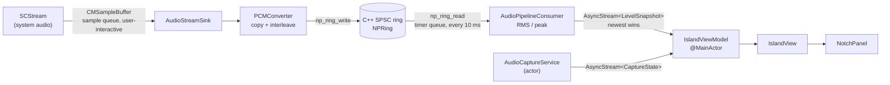
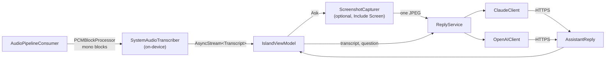
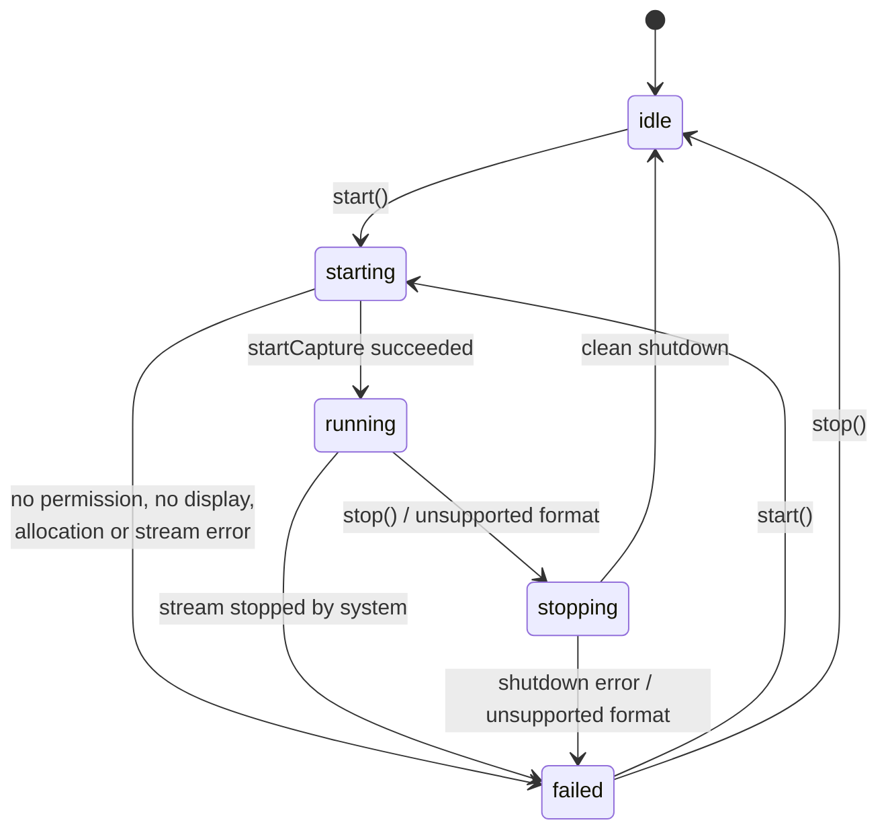

# NotchPilot

NotchPilot is a macOS menu-bar utility with a Dynamic-Island-inspired panel at the top of the primary display. When you start it, it captures system audio (what your Mac plays, not the microphone) through ScreenCaptureKit and passes the samples through a C++20 lock-free single-producer/single-consumer (SPSC) ring buffer to a non-real-time consumer that measures levels for the island's meter. Capture is off until you turn it on. While capture runs, the audio is transcribed on-device (Speech framework, `requiresOnDeviceRecognition`), and when you press **Ask** the recent transcript is sent to an AI reply service of your choice (Claude through the Anthropic Messages API, or ChatGPT through the OpenAI Chat Completions API) using your own API key, optionally with one on-demand screenshot of the main display. NotchPilot is not affiliated with Apple and does not imitate system UI; the island is its own opaque black panel.

- [Prerequisites](#prerequisites)
- [Build, run, test](#build-run-test)
- [Project layout](#project-layout)
- [Architecture](#architecture)
- [Audio format and real-time contract](#audio-format-and-real-time-contract)
- [Assistant: transcription, replies and screenshots](#assistant-transcription-replies-and-screenshots)
- [Settings window](#settings-window)
- [Window behaviour](#window-behaviour)
- [Configuration](#configuration)
- [Permissions and privacy](#permissions-and-privacy)
- [Known limitations](#known-limitations)
- [Troubleshooting](#troubleshooting)
- [License](#license)

## Prerequisites

| Requirement | Detail |
|---|---|
| macOS | 14 or later (`platforms: [.macOS(.v14)]`) |
| Toolchain | Xcode 16+ / Swift 6.0+ with Swift/C++ interoperability (available since Swift 5.9) |
| Verified with | Xcode 27.0, Swift 6.4, macOS (arm64) |

`Package.swift` uses `// swift-tools-version: 6.0`, so older toolchains fail with a clear message.

**C++ interoperability.** `NotchPilotCore`, `NotchPilot` and the test target enable `.interoperabilityMode(.Cxx)` (shared through `swiftCommon` in `Package.swift`). Every Swift target that imports `NPRingBuffer` needs it. If interop is off, `Sources/NPRingBuffer/include/NPRingBuffer.h` stops the build with this `#error`:

```
NPRingBuffer.h must be compiled as C++. Enable Swift C++ interoperability: SwiftPM `.interoperabilityMode(.Cxx)` or Xcode 'C++ and Objective-C Interoperability' = 'C++ / Objective-C++' (-cxx-interoperability-mode=default).
```

If you add the sources to an Xcode project, set **C++ and Objective-C Interoperability** to **C++ / Objective-C++** on every Swift target that imports `NPRingBuffer`.

## Build, run, test

Scripts (`scripts/`):

```sh
scripts/build.sh            # release build, assembles and signs NotchPilot.app
scripts/build.sh --debug    # debug build (enables the C++ ownership asserts)
scripts/build.sh --run      # build, then launch the app
scripts/build.sh --help
scripts/test.sh             # swift test (92 Swift tests) + C++ tests under TSan and ASan/UBSan
scripts/test.sh --cpp-only  # C++ tests only
```

`scripts/build.sh` signs ad hoc by default. Set `CODESIGN_IDENTITY` to a stable identity (see [Troubleshooting](#troubleshooting)):

```sh
CODESIGN_IDENTITY="Apple Development: Your Name (TEAMID)" scripts/build.sh --run
```

`Resources/Info.plist` sets `LSUIElement` (no Dock icon), bundle identifier `app.notchpilot.NotchPilot`, and one usage-description key, `NSSpeechRecognitionUsageDescription` (shown in the Speech Recognition prompt). There is deliberately no microphone or camera key: Screen & System Audio Recording has no Info.plist key, and NotchPilot never touches the microphone or camera.

Raw SwiftPM equivalents:

```sh
swift build                 # debug
swift build -c release
swift run NotchPilot        # runs the bare executable (no app bundle)
swift test                  # Swift tests (NotchPilotCoreTests, 92 tests)
```

`swift run` works for UI work because `main.swift` sets the `.accessory` activation policy itself. For a stable TCC identity use the bundled app from `scripts/build.sh`.

**Why SwiftPM instead of an `.xcodeproj`.** The project builds reproducibly from the command line with no project generator (xcodegen was not available), the C++ target, interop flag and C++20 standard are declared in one reviewable `Package.swift`, and there is no generated project file to keep in sync. The `.app` bundle is assembled by `scripts/build.sh`.

## Project layout

```
Package.swift
Resources/Info.plist             LSUIElement, bundle id, NSSpeechRecognitionUsageDescription
scripts/build.sh, test.sh
Sources/
  NPRingBuffer/                  C++20 target
    include/NPRingBuffer.h       only surface Swift imports (opaque NPRing* + np_ring_* functions)
    SPSCRingBuffer.hpp           np::SPSCRingBuffer<Sample> template
    NPRingBuffer.cpp             bridge implementation
  NotchPilotCore/                Swift 6 + C++ interop, no AppKit UI
    Config/NotchPilotConfig.swift
    Geometry/IslandGeometry.swift     pure layout math (DisplayMetrics, IslandPresentation)
    Audio/AudioCaptureService.swift   actor: SCStream lifecycle, CaptureState
    Audio/AudioStreamSink.swift       SCStreamOutput on the sample queue (real-time producer)
    Audio/PCMConverter.swift          CMSampleBuffer -> interleaved Float32
    Audio/RingBuffer.swift            ~Copyable RingProducer / RingConsumer over NPRing
    Audio/AudioPipelineConsumer.swift timer-driven drain, levels, AsyncStream output
    Audio/CaptureError.swift
    Assistant/AssistantInterfaces.swift  AIProvider, AssistantSettings, ReplyRequest, AssistantReply,
                                         AssistantError, Transcript, TranscriptionState, protocols
    Speech/SystemAudioTranscriber.swift  on-device SFSpeechRecognizer, PCMBlockProcessor
    Speech/SpeechText.swift
    AI/ReplyService.swift, ClaudeClient.swift, OpenAIClient.swift
    AI/ProviderHTTP.swift, KeychainAPIKeyStore.swift
    Screenshot/ScreenshotCapturer.swift  SCScreenshotManager, JPEG in memory
  NotchPilot/                    AppKit/SwiftUI executable
    App/main.swift, AppDelegate.swift, MainMenu.swift
    MenuBar/StatusItemController.swift
    Settings/SettingsView.swift, SettingsWindowController.swift, AssistantSettingsStore.swift
    Panel/NotchPanel.swift, IslandPanelController.swift
    Island/IslandViewModel.swift, IslandView.swift, IslandShape.swift, AssistantViews.swift
Tests/
  NotchPilotCoreTests/           Swift Testing
  cpp/ring_buffer_tests.cpp      standalone C++ tests (no framework)
```

## Architecture

### Data flow



Assistant extension (see [Assistant](#assistant-transcription-replies-and-screenshots)):



Format problems found on the real-time path do not call out: the sink records them in the ring's reject counters, and the consumer polls them and notifies `AudioCaptureService`.

### Capture state machine

`CaptureState` in `AudioCaptureService.swift`:



`start()` is ignored while the state is `starting`, `running` or `stopping`. `start()` and `stop()` are serialised through a task chain. Pressing Stop while starting also sets a cancellation flag that `performStart` checks after every suspension point, so a start in progress is abandoned (and a stream that already started is torn down) instead of capturing first.

### Threading and isolation

| Component | Runs on | Notes |
|---|---|---|
| `AudioCaptureService` | its own actor | Owns `SCStream`, `Session` (stream, sink, consumer), state. Never on the real-time path. |
| `AudioStreamSink`, `PCMConverter` | serial queue `app.notchpilot.audio-capture` (`.userInteractive`) | Real-time producer. No allocation, locks, logging, actor hops or UI work. |
| C++ ring | any thread | One producer side, one consumer side; atomics only. |
| `AudioPipelineConsumer` | serial queue `app.notchpilot.audio-consumer` (`.userInitiated`) | `DispatchSourceTimer` (non-blocking), drains full blocks, vDSP RMS/peak. |
| `IslandViewModel`, `IslandView`, `NotchPanel`, `IslandPanelController`, `StatusItemController`, `AppDelegate` | `@MainActor` | Only receive bounded `AsyncStream` values; never touched by audio threads. |

`states` is `bufferingNewest(8)`; `levels` is `bufferingNewest(1)`.

### Audited `@unchecked Sendable` boundaries

| Type | Invariant (from the code comments) |
|---|---|
| `RingStorage` (`RingBuffer.swift`) | Only mutable state lives behind the C++ atomics; Swift stored properties are immutable. It owns the `NPRing` and destroys it in `deinit`. Producer and consumer hold strong references, so the C++ object outlives every caller, including a late capture callback racing teardown. |
| `RingProducer`, `RingConsumer` (`RingBuffer.swift`) | `~Copyable`, so a handle has one owner. `RingBuffer.init` creates exactly one of each, which enforces SPSC in the type system. Moving a handle to the queue that uses it is the intended use; the C++ side synchronises with acquire/release atomics. |
| `AudioStreamSink` (`AudioStreamSink.swift`) | `converter` and `producer` are used only inside `stream(_:didOutputSampleBuffer:of:)`, which ScreenCaptureKit calls serially on `sampleQueue`. All other stored properties are immutable. The sink never references UI objects. |
| `AudioPipelineConsumer` (`AudioPipelineConsumer.swift`) | Every mutable property is read and written only on its `queue` (asserted with `dispatchPrecondition` in debug builds). `start()` and `stop()` hop onto the queue themselves. |

`AudioCaptureService` additionally holds `processor` as `nonisolated(unsafe) weak var`; `PCMBlockProcessor` is `AnyObject, Sendable`.

## Audio format and real-time contract

**Published format.** Float32, native endian, interleaved, 48 kHz, 2 channels by default (`NotchPilotConfig.Audio`). `PCMFormat.description` renders it as `48 kHz · Stereo · Float32`.

**Conversion rules** (`PCMConverter`):

- Mono source: the sample is duplicated to every output channel.
- Stereo source to mono output: the first two channels are averaged.
- Source channels beyond the output count are ignored (a guard, not a mixer).
- No resampling. A source whose sample rate differs from the configured rate by 0.5 Hz or more is rejected (`sampleRateMismatch`).
- Rejection policy: structural problems (`notLinearPCM`, `notFloat32` incl. big-endian or non-packed, `sampleRateMismatch`, `tooManyChannels`) stop capture with "Unsupported Audio Format". Per-buffer problems (`bufferTooLarge`, `copyFailed`, `missingFormat`) are only counted in `framesRejected`; capture continues.
- Rejected inputs (counted in `framesRejected`, reason in `lastRejectReason`): not linear PCM, not 32-bit float, more than 8 channels, sample-rate mismatch, buffer larger than `maxFramesPerCallback`, copy failure, missing format description. The consumer sees a rejection and capture stops with `CaptureError.unsupportedFormat`.

**Buffer lifetime.** Audio is copied out of the `CMSampleBuffer` with `CMSampleBufferCopyPCMDataIntoAudioBufferList` into converter-owned scratch memory preallocated in `init` (input scratch for up to 8 channels, plus an interleaved output block). No pointer into a framework-owned buffer outlives the callback that delivered it.

**Ring buffer** (`SPSCRingBuffer.hpp`):

- Capacity is rounded up to a power of two so the index is a single AND. The default request is `1 << 15` frames (about 0.68 s at 48 kHz). Maximum is `1 << 24` frames.
- `head_` (producer) and `tail_` (consumer) are 64-bit monotonic counters on separate cache lines. Each side publishes with a release store after touching sample memory and observes the other side with an acquire load.
- `static_assert` requires lock-free 64-bit atomics on the target.
- `write()` and `read()` do no allocation, locking, system calls or logging.
- **Overflow:** `write()` stores the frames that fit, drops the newest remainder, and counts `framesDropped` and `overflowEvents`. Old audio is never overwritten.
- **Underrun:** `read()` returns fewer frames than requested when not enough are buffered and counts an `underrunEvents`. It never blocks or pads. The consumer reads only full blocks (`consumerBlockFrames`), so its own polling does not cause underruns.
- **Debug ownership asserts:** debug builds define `NP_RING_DEBUG_OWNERSHIP=1`, which asserts that no second producer or consumer enters concurrently. The C++ test binary also uses it.
- `RingProducer` and `RingConsumer` are `~Copyable` handles over a shared `RingStorage`.

**Teardown order** (`AudioCaptureService.teardown`):

1. Stop the stream (`SCStream.stopCapture`; "already stopped" is ignored).
2. Remove the audio output.
3. `AudioStreamSink.drainCallbacks()` waits for callbacks already queued on `sampleQueue`.
4. `AudioPipelineConsumer.stop()` cancels the timer, drains remaining frames (including the final partial block, read exactly so it is not counted as an underrun) and yields a final snapshot.
5. Release the session; `RingStorage.deinit` destroys the ring.

`AppDelegate.applicationShouldTerminate` stops active capture before quitting.

## Assistant: transcription, replies and screenshots

**Transcription.** `IslandViewModel.captureStateDidChange` starts `SystemAudioTranscriber` when capture is `running` and stops it on `idle` or `failed`, so transcription runs exactly while capture runs. The transcriber is a `PCMBlockProcessor` fed by `AudioPipelineConsumer`; it downmixes blocks to mono and hands them to its own serial queue (`app.notchpilot.speech`), so the consumer never waits on the recogniser. It always sets `requiresOnDeviceRecognition`. If on-device recognition is not available (for example for the current locale), the state is `TranscriptionState.unavailable` and there is no server fallback. Recognition tasks end on their own and are restarted; completed utterances accumulate in `Transcript.finalText` (capped at about 20k characters), the utterance in progress is `partialText`. The transcript is in memory only; **Clear Transcript** in the status menu empties it (`IslandViewModel.clearTranscript()`).
**Ask.** The expanded island has a question `TextField`, an **Include Screen** toggle and an **Ask** button (Return in the field also asks). `IslandViewModel.ask()` is the only code path that touches the network:

1. If there is neither transcript text nor a question, it fails with `nothingToSend` before anything is captured.
2. If Include Screen is on, `ScreenshotCapturer` takes one screenshot of the main display.
3. `ReplyService` reads the API key from the Keychain and calls `ClaudeClient` or `OpenAIClient`, depending on `AssistantSettings.provider`.
4. The reply (or a failure notice) is shown in the island; Copy is available on a reply.

### What is sent per request

Exactly one HTTPS request to the provider you chose:

| Part | Content |
|---|---|
| Transcript | `Transcript.recentText(limit:)`: the last `transcriptCharacterLimit` characters (default 6000), cut at a word boundary |
| Question | Optional text from the question field; without one, the prompt asks the model to respond to what is being said |
| System prompt | `AssistantSettings.systemPrompt` |
| Screenshot | Only if Include Screen is on: one JPEG of the main display, long edge at most 1568 px, quality 0.7, NotchPilot's own windows excluded, cursor hidden |

The user text is `Transcript of audio playing on my Mac (most recent last):` followed by the transcript, then `My question: ...` or `Respond helpfully to what's being said.` Requests use an ephemeral `URLSession` with no cache and a 600 s idle timeout (replies are non-streaming, so no bytes arrive until generation finishes). Nothing is logged: not keys, transcripts, bodies or screenshots.

### Claude (Anthropic Messages API)

| Item | Value |
|---|---|
| Endpoint | `POST https://api.anthropic.com/v1/messages` |
| Headers | `x-api-key`, `anthropic-version: 2023-06-01`, `anthropic-beta: server-side-fallback-2026-07-01`, `content-type: application/json` |
| Model | `claudeModel`, default `claude-opus-5-5` |
| Body | `model`, `max_tokens` 16000, `system`, one user message (image block first when present, then text), `output_config.effort` from `claudeEffort`, `fallbacks: "default"` (server-side fallback) |
| Not sent | `thinking`, `temperature`, `top_p` |
| Reply | Text blocks joined. `stop_reason` `refusal` becomes `AssistantError.refused`; `max_tokens` marks the reply as truncated |

`claudeEffort` is `low` by default; the Settings window offers Low, Medium and High.

### ChatGPT (OpenAI Chat Completions)

| Item | Value |
|---|---|
| Endpoint | `POST https://api.openai.com/v1/chat/completions` |
| Headers | `Authorization: Bearer <key>`, `content-type: application/json` |
| Model | `openAIModel`, default `gpt-5`. It is configurable: set a model your account has access to |
| Body | `model`, `max_completion_tokens` 16000 (includes reasoning tokens; an empty reply is reported as an error, not shown blank), a system message and a user message (text part, then an `image_url` part with a `data:image/jpeg;base64,...` URL when a screenshot is attached) |
| Reply | `choices[0].message.content`; a `refusal` becomes `AssistantError.refused`; `finish_reason` `length` marks the reply as truncated |

### Errors

| Condition | `AssistantError` |
|---|---|
| No key saved | `missingAPIKey` ("API Key Needed") |
| HTTP 401, 403 | `invalidAPIKey` ("API Key Not Accepted") |
| HTTP 429 | `rateLimited` (uses `retry-after` when present) |
| HTTP 500, 502, 503, 529 | `providerUnavailable` |
| Other non-2xx (for example an unknown model) | `requestRejected`, told to check the model name in Settings; the HTTP status and provider message are in the tooltip only |
| Transport failure | `network` ("No Connection") |
| Unreadable body | `invalidResponse` |
| Model declined | `refused` |
| Nothing to send | `nothingToSend` |
| Keychain failure | `keychain(OSStatus)` |

Screenshot failures (`ScreenshotError`: `permissionDenied`, `noDisplay`, `captureFailed`, `encodingFailed`) are shown the same way, with an **Open Privacy Settings** fix for a denied permission.

### Cancellation

Cancel in the island cancels the Ask task (`cancelAsk`): a cancelled `URLSession` request surfaces as `CancellationError` and the island returns to idle without an error. Ask is ignored while another Ask is running.

## Settings window

Open it from the status menu (**Settings...**) or with Command-comma. The window is titled "NotchPilot Settings", fixed size, close button only.

| Field | Meaning |
|---|---|
| Provider | Claude or ChatGPT (`AIProvider`) |
| API Key | `SecureField` per provider. Once saved the row only says "Saved in Keychain" with a **Remove...** button; the key is never shown again |
| Model | Per-provider model name; blank falls back to the default |
| Effort | Claude only: Low, Medium, High |
| Include screen by default | Initial state of the Include Screen toggle |
| System Prompt | Editable, with **Restore Default** |

Below the prompt the window states what leaves the Mac and when (see [privacy](#permissions-and-privacy)).

**Storage.** API keys go to the Keychain: generic password, service `app.notchpilot.apikeys`, account `claude` or `openAI`, stored in the user's login keychain. The item sets `kSecAttrAccessibleWhenUnlockedThisDeviceOnly`, but the file-based login keychain does not enforce that attribute: an ad-hoc-signed build cannot use the data-protection keychain, so access is governed by the item's ACL and macOS asks you before any other app reads it. The key is not device-bound. A Developer-ID-signed release could add `kSecUseDataProtectionKeychain` for that. Everything else in `AssistantSettings` is stored as JSON in `UserDefaults` under the key `AssistantSettings`. The Keychain is touched only when Settings opens or when you Ask or save a key, not at launch.

## Window behaviour

### `NotchPanel` settings

| Setting | Value |
|---|---|
| Style mask | `.borderless`, `.nonactivatingPanel` |
| `isFloatingPanel` | `true` |
| `level` | `.statusBar` |
| `collectionBehavior` | `.canJoinAllSpaces`, `.stationary`, `.ignoresCycle`; plus `.fullScreenAuxiliary` if `showOverFullScreenApps` |
| `hidesOnDeactivate` | `false` |
| `becomesKeyOnlyIfNeeded` | `true` |
| `isReleasedWhenClosed` | `false` |
| `sharingType` | `.none` when `excludeFromScreenSharing` (best effort, see [privacy](#permissions-and-privacy)) |
| Also | `canBecomeKey = true`, `canBecomeMain = false`, not movable, no window animation, transparent background, accessibility role `.popover`, label "NotchPilot" |

### Placement and resizing

- The island is placed on `NSScreen.screens.first` (the primary display).
- **Notch-attached:** when `attachToNotch` is on and the display reports a camera housing (`safeAreaInsets.top` and the auxiliary top areas), the island is flush with the physical top edge, has square top corners and concave shoulders, and is sized to the notch width plus a wing on each side.
- **Floating:** on displays without a notch, a capsule of `compactSizeWithoutNotch` sits `floatingTopMargin` below the menu bar, rounded on all corners, with a thin key line.
- **Grow before expand, shrink after collapse.** The panel frame is set to the target size before the expand animation starts and shrinks only after the collapse animation completes (`presentationWillChange` / `presentationDidSettle`). The window never animates; SwiftUI animates the island inside it. In the compact resting state the panel covers only the island. A newer transition retargets the running one, and only the latest completion resizes the panel.
- **Display changes:** `NSApplication.didChangeScreenParametersNotification` recomputes geometry and the panel frame.

### Interaction

| Input | Result |
|---|---|
| Click the island header | Expand or collapse |
| Escape (while the panel is key) | Collapse. Only "Show Controls" in the menu makes the non-activating panel key (NotchPilot is not activated); clicks and background updates never do, and collapsing hands key status back to the frontmost app. |
| Click outside | Collapse. A global mouse-down monitor is installed only while expanded; it observes events and cannot modify or consume them. |
| Question field | Click to type. The panel becomes key without activating NotchPilot (`NotchPanel.canBecomeKey`, `IslandViewModel.beginTyping`), so the frontmost app stays active |
| Menu-bar item | Start/Stop Capture (Cmd-R in the open menu), Show Controls, Show/Hide Island, Clear Transcript, Settings... (Cmd-comma), Open Privacy Settings, Quit |
| Hover | Expands after `hoverExpandDelay` only if `expandOnHover` is enabled (off by default) |

**Editing keys and Settings.** An `.accessory` app has no visible main menu, but AppKit still routes key equivalents through it. `MainMenu` installs a hidden main menu with an Edit menu (Undo, Redo, Cut, Copy, Paste, Select All) so Command-C/V work in the question field and when pasting an API key, plus Settings... and Quit. Opening Settings activates the app temporarily (`NSApp.activate()`); closing the window deactivates it again, which hands focus back to the previous app.

### Reduce Motion and accessibility

- With Reduce Motion on, the springs are replaced by an `easeInOut` of `reducedMotionFade` seconds and content fades without scaling.
- The header button is labelled "NotchPilot, <status>" with a hint; the Start Capture / Stop Capture / Open Privacy Settings buttons (black labels on light capsules, ≥ 6.2:1) and the level bar have labels and values; Return triggers the primary button after "Show Controls"; failures are announced to VoiceOver even while collapsed; telemetry has a spoken form; the status item has an accessibility label.
- The state glyph pairs colour with shape (red waveform while capturing, spinner, warning triangle, grey waveform when idle). With Reduce Motion on, the meters stop animating and move in four discrete steps. The status item uses a distinct filled symbol while capturing.

### Design tokens (`IslandPalette`)

The island is always an opaque black surface with fixed dark-appearance colours. Ratios below are the values documented in `IslandView.swift`, against `#000`:

| Token | Value | Contrast |
|---|---|---|
| `primary` | white 92% | 18.9:1 |
| `secondary` | white 62% | 8.0:1 |
| `live` (capturing) | `systemRed` | 5.6:1 |
| `level` (audio level) | `systemTeal` | 10.6:1 |
| `attention` | `systemYellow` | not listed in source |
| `idleGlyph` | white 55% | not listed in source |
| `keyline` | white 14% (45% with Increase Contrast) | n/a |

## Configuration

All tunables live in `NotchPilotConfig` (`Sources/NotchPilotCore/Config/NotchPilotConfig.swift`). They are compile-time defaults: edit and rebuild. `AppDelegate` uses `NotchPilotConfig.default`.

### `layout`

| Field | Default | Meaning |
|---|---|---|
| `compactWingWidth` | 40 | Width of each side wing flanking the camera housing in compact state |
| `compactSizeWithoutNotch` | 200 x 32 | Compact size on displays without a camera housing |
| `minimumNotchHeight` | 32 | Fallback compact height if a notched display reports no safe-area inset |
| `expandedContentSize` | 460 x 208 | Expanded content area, measured below the housing / top edge: status, level bar, live transcript, Ask row and footer |
| `expandedNoticeHeight` | 74 | Extra expanded height while an Ask is in progress or has failed |
| `expandedReplyHeight` | 140 | Extra expanded height while a reply is shown (about five lines) |
| `compactCornerRadius` | 12 | Bottom corner radius, compact |
| `expandedCornerRadius` | 24 | Bottom corner radius, expanded |
| `shoulderRadius` | 8 | Concave shoulder radius where a notch-attached island meets the menu bar |
| `floatingTopMargin` | 6 | Gap between the menu bar and a floating island |
| `shadowMargin` | 18 | Transparent margin so the shadow is not clipped |
| `contentInset` | 14 | Inset that keeps content concentric with the rounded edge |

### `animation`

| Field | Default | Meaning |
|---|---|---|
| `expandResponse` | 0.42 | Spring response (seconds) when opening |
| `expandDamping` | 0.80 | Spring damping fraction when opening |
| `collapseResponse` | 0.34 | Spring response when closing |
| `collapseDamping` | 0.92 | Spring damping fraction when closing |
| `reducedMotionFade` | 0.18 | Cross-fade duration (seconds) used with Reduce Motion |
| `hoverExpandDelay` | 0.35 | Seconds the pointer must rest before hover expansion |
| `meterRefreshHz` | 20 | Level meter publish rate (Hz) |

### `audio`

| Field | Default | Meaning |
|---|---|---|
| `sampleRate` | 48000 | Published sample rate; other source rates are rejected |
| `channelCount` | 2 | Published channel count |
| `ringCapacityFrames` | 32768 (`1 << 15`) | Ring capacity request; rounded up to a power of two |
| `maxFramesPerCallback` | 8192 | Largest buffer accepted per callback; larger ones are rejected, not allocated for |
| `consumerBlockFrames` | 1024 | Block size the consumer drains and analyses (minimum 64) |
| `consumerInterval` | 0.010 | Consumer timer interval in seconds (minimum 0.002) |
| `excludesCurrentProcessAudio` | `true` | Exclude NotchPilot's own audio from capture |

### `features`

| Field | Default | Meaning |
|---|---|---|
| `expandOnHover` | `false` | Expand when the pointer rests on the island |
| `attachToNotch` | `true` | Attach to the camera housing on displays that have one |
| `showOverFullScreenApps` | `false` | Add `.fullScreenAuxiliary` so the island appears over full-screen apps |
| `excludeFromScreenSharing` | `true` | Set `NSWindow.sharingType = .none` |
| `showTelemetry` | `false` | Diagnostic: show dropped and rejected frame counts in the expanded island |

### `AssistantSettings`

Not part of `NotchPilotConfig`: these are runtime preferences edited in the [Settings window](#settings-window) and persisted in `UserDefaults` (key `AssistantSettings`). API keys are not part of this type.

| Field | Default | Meaning |
|---|---|---|
| `provider` | `.claude` | `.claude` (Claude) or `.openAI` (ChatGPT) |
| `claudeModel` | `claude-opus-5-5` | Model sent to the Anthropic Messages API |
| `claudeEffort` | `low` | `output_config.effort`: low, medium, high, xhigh or max (Settings offers the first three) |
| `openAIModel` | `gpt-5` | Model sent to OpenAI Chat Completions; set one your account has |
| `systemPrompt` | "You are NotchPilot, a concise assistant on a Mac. ..." | Instruction sent with every request |
| `includeScreenshotByDefault` | `false` | Initial state of Include Screen |
| `transcriptCharacterLimit` | 6000 | Most recent transcript characters sent per request |

## Permissions and privacy

- **Off by default.** The app launches with capture idle. Capture starts only when you choose Start (island or menu). Transcription runs only while capture runs.
- **Visible indicators** while capturing: a red waveform glyph in the island (compact and expanded), the filled `waveform.circle.fill` status-item symbol, and macOS's own system recording indicator.
- **Stop is always available** in the island (while starting or running) and in the menu ("Stop Capture").
- **No video stream.** No `.screen` output is registered for capture, so video frames are never delivered to NotchPilot. The only image NotchPilot ever takes is the on-demand screenshot described below.
- **Microphone excluded** (`captureMicrophone = false` on macOS 15+; system audio only).
- **Own audio excluded** (`excludesCurrentProcessAudio`, on by default).
- **Transcription never leaves the Mac.** Recognition is on-device only (`requiresOnDeviceRecognition`); there is no server fallback.
- **Network only on Ask**, and only to the provider you chose (`api.anthropic.com` or `api.openai.com`). One request contains the recent transcript, your optional question, the system prompt and, only if Include Screen is on, one screenshot. There is no analytics and no other network use.
- **Screenshot** only when Include Screen is on and you press Ask. It is JPEG-encoded in memory, sent in that request, and never saved.
- **API keys** are in your login keychain. They are not device-bound: macOS asks before another app reads them (see [Settings window](#settings-window)).
- **Nothing is logged** (keys, transcripts, request bodies, screenshots) and the HTTP session is ephemeral with no cache. Audio, transcripts, screenshots and replies exist only in memory. Only the non-secret `AssistantSettings` JSON is written to `UserDefaults`.
- **Island footer.** The expanded island shows "Transcribed on this Mac · Sent only when you Ask". Its tooltip reads: "Audio, transcripts and screenshots stay in memory and are never saved. Ask sends one request to <provider>."
- **`sharingType = .none` is best effort, not a guarantee.** It asks the window server to exclude the panel from window sharing and capture. Recent macOS versions ignore it for ScreenCaptureKit-based capture (which is what most current screen recorders and sharing apps use), so treat it as a courtesy flag for older capture paths only.

**Permissions.**

| Permission | Used for | When it is requested |
|---|---|---|
| Screen & System Audio Recording | System audio capture; the optional screenshot | Capture: when you start capture (listing shareable content). Screenshot: `ScreenshotCapturer` checks `CGPreflightScreenCaptureAccess()` and reports `permissionDenied` rather than prompting |
| Speech Recognition | On-device transcription | When you press Start, `SystemAudioTranscriber.requestAuthorization()` runs first. If undecided, the island shows a Continue button that shows the prompt |
| Keychain | Storing API keys | When you save, read or remove a key (opening Settings, saving a key, Ask). Not at launch. With ad-hoc signing macOS may ask to allow access |

**Permission flow.** Starting capture triggers the Screen & System Audio Recording prompt. If access is denied, the island shows "Permission Needed" with an **Open Privacy Settings** button, and the menu offers the same item. Manual path: System Settings > Privacy & Security > Screen & System Audio Recording, enable NotchPilot, then start capture again. Speech Recognition is under Privacy & Security > Speech Recognition. macOS may periodically ask you to re-confirm the screen permission.

## Known limitations

- The interactive capture and permission (TCC) flow needs a human on a Mac; it is not covered by automated tests.
- With ad-hoc signing the code identity changes on every rebuild, so macOS may ask for permission again.
- ScreenCaptureKit requires a display content filter to deliver system audio, so a 2x2 px, at most 1 fps video stream exists. NotchPilot registers no screen output and discards that video.
- Real calls to the Anthropic and OpenAI APIs, TCC prompts (Screen & System Audio Recording, Speech Recognition), Keychain prompts with ad-hoc signing, and on-device speech availability per language are not verified by automated tests. The tests cover 92 Swift tests plus the C++ suite under TSan and ASan/UBSan.
- On-device recognition may be unavailable for some locales or Macs. The state is then `unavailable` and transcription does not fall back to a server.
- OpenAI has no default-model guarantee: if your account lacks `gpt-5`, set another model in Settings.
- No resampling: audio whose sample rate differs from `audio.sampleRate` is rejected and capture stops.
- Primary display only: the island is placed on `NSScreen.screens.first`, and capture uses the main display (`CGMainDisplayID()`, falling back to the first available display).

## Troubleshooting

| Symptom | Fix |
|---|---|
| Permission keeps being requested or denied after rebuilds | Reset the grant: `tccutil reset ScreenCapture app.notchpilot.NotchPilot`. Then build with a stable identity (`CODESIGN_IDENTITY=...`) so the grant survives rebuilds. |
| Speech Recognition permission stuck or denied | `tccutil reset SpeechRecognition app.notchpilot.NotchPilot`, then start capture again. Or enable it under System Settings > Privacy & Security > Speech Recognition. |
| "API Key Needed" or "API Key Not Accepted" | Open Settings (status menu or Cmd-comma), paste the key for the selected provider and Save. If it was rejected, remove it and save a valid one. |
| "Request Not Accepted" / model not found | The model name is unknown to your account. Set a model name your account has in Settings (blank restores the default). |
| "Keychain Error" | Save the key again; allow Keychain access if macOS asks. |
| Build fails with the `NPRingBuffer.h must be compiled as C++` error | Enable C++ interop on the target (`.interoperabilityMode(.Cxx)`, or the Xcode setting under [Prerequisites](#prerequisites)). |
| Island is hidden over a full-screen app | Set `features.showOverFullScreenApps = true` in `NotchPilotConfig` and rebuild. |
| Console shows "stream output NOT found" | Log noise from ScreenCaptureKit, since NotchPilot registers only an audio output. |
| Island is missing from the menu bar area | Use the status item > Show Island. |

## License

MIT. See `LICENSE`.
